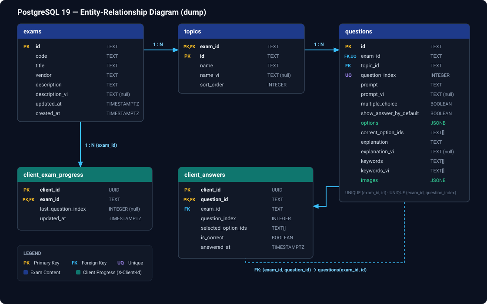
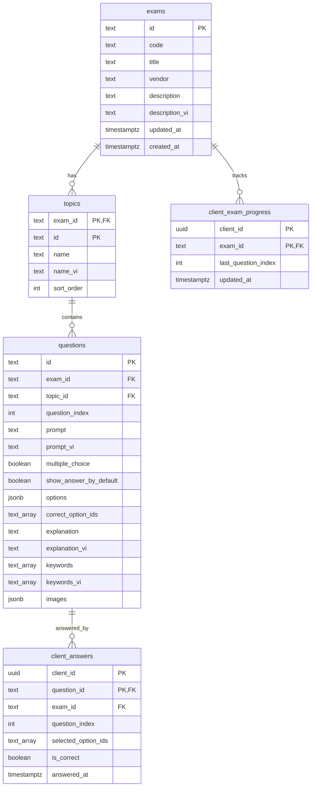

# PostgreSQL Database Schema & Migrations

This document describes the PostgreSQL 19 schema, constraints, indexes, and migration/seed workflow for the `dump` application.

## 1. Entity-Relationship Diagram





### Table Relationship Overview (Text Diagram)

```text
exams (id PK)
 ├──< topics (PK: exam_id, id | FK: exam_id -> exams.id)
 │     └──< questions (id PK | UNIQUE: (exam_id, id), (exam_id, question_index) | FK: (exam_id, topic_id) -> topics)
 │           └──< client_answers (PK: client_id, question_id | FK: (exam_id, question_id) -> questions(exam_id, id))
 └──< client_exam_progress (PK: client_id, exam_id | FK: exam_id -> exams.id)
```

---

## 2. Key Design Decisions

- **Composite PK on `topics (exam_id, id)`:** Allows different exams to reuse short topic IDs (e.g., `intro`, `pim`, `security`) without collisions.
- **Composite FK on `client_answers (exam_id, question_id)` → `questions (exam_id, id)`:** Enforces at the database level that a submitted answer's `exam_id` always matches the owning exam of `question_id`.
- **Plain `TEXT` + Inline Media Placeholders (`[[img:<id>]]`):** `prompt`, `prompt_vi`, `explanation`, and `explanation_vi` store plain text; inline images are referenced by placeholder tokens resolved against `questions.images` (`JSONB` array of `{ id, url, alt }`).
- **`options` as `JSONB`:** Stores `[{ id, label, text, textVi }]` directly on `questions` to avoid extra joins per question while preserving option order.
- **`show_answer_by_default`:** Allows non-choice `SIMULATION` questions to store `options = '[]'` and `correct_option_ids = '{}'` while keeping `CHECK (show_answer_by_default OR cardinality(correct_option_ids) >= 1)` enforced for standard choice questions.
- **Per-Client Isolation (`client_id UUID`):** `client_exam_progress` and `client_answers` isolate progress by the browser's `X-Client-Id` UUID.

---

## 3. Indexes

| Table | Index | Purpose |
| :--- | :--- | :--- |
| `exams` | `idx_exams_updated_at (updated_at DESC)` | Default exam list ordering |
| `topics` | `idx_topics_exam_sort (exam_id, sort_order)` | Ordered topic listing per exam |
| `questions` | `idx_questions_exam_topic_index (exam_id, topic_id, question_index)` | Topic-scoped question lookup & navigator |
| `questions` | `UNIQUE (exam_id, question_index)` | Fast `q` lookup and unique numbering per exam |
| `questions` | `UNIQUE (exam_id, id)` | Target for `client_answers` composite FK |
| `client_exam_progress` | `idx_client_exam_progress_exam (exam_id)` | Cascade deletes & per-exam lookup |
| `client_answers` | `idx_client_answers_client_exam (client_id, exam_id, question_index)` | Fast `answeredCount` & `navItems` aggregation |

---

## 4. Migrations & Seeding

All connection settings are read from the repository-root `.env` (`DATABASE_URL`, `PGHOST`, `PGPORT`, `PGUSER`, `PGPASSWORD`, `PGDATABASE`).

```powershell
# Apply pending migrations
sqlx migrate run --source backend/migrations

# Check migration status
sqlx migrate info --source backend/migrations

# Seed MB-330 (first 20 questions, idempotent)
psql -v ON_ERROR_STOP=1 -f backend/seeds/001_mb330_20q.sql
```
