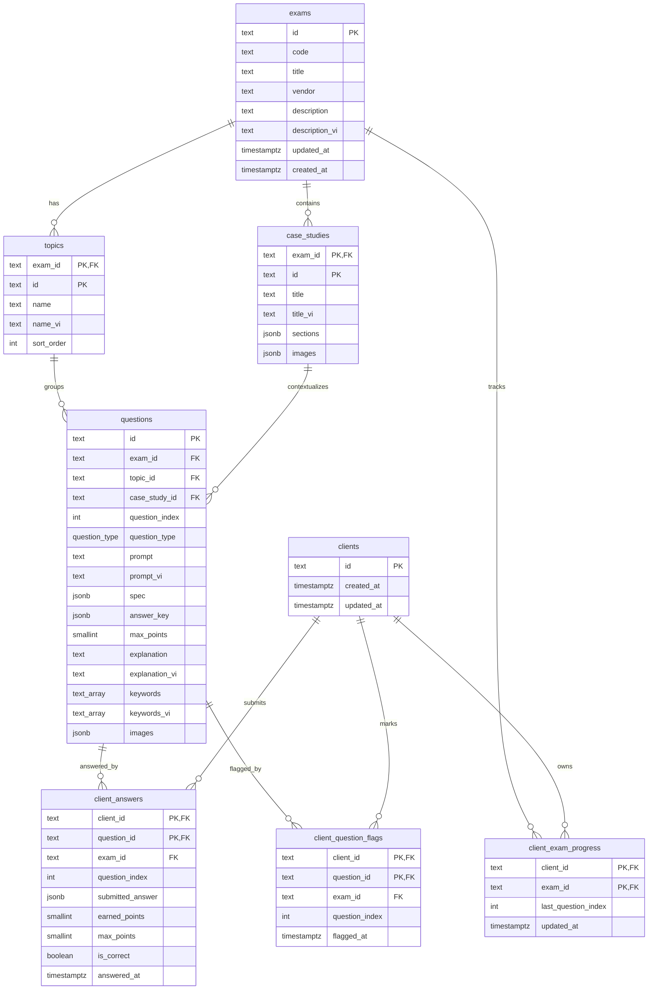

# PostgreSQL Database Schema & Migrations

This document describes the PostgreSQL 19 schema, constraints, indexes, and migration/seed workflow for the `dump` application (v2 Microsoft-exam-style schema).

## 1. Entity-Relationship Diagram




### Table Relationship Overview (Text Diagram)

```text
exams (id PK)
 ├──< topics (PK: exam_id, id | FK: exam_id -> exams.id)
 │     └──< questions (id PK | UNIQUE: (exam_id, id), (exam_id, question_index))
 ├──< case_studies (PK: exam_id, id | FK: exam_id -> exams.id)
 │     └──< questions (FK: (exam_id, case_study_id) -> case_studies, ON DELETE SET NULL)
 └──< client_exam_progress (PK: client_id, exam_id | FK: client_id -> clients.id, exam_id -> exams.id)

questions (UNIQUE: exam_id, id)
 ├──< client_answers (PK: client_id, question_id | FK: (exam_id, question_id) -> questions)
 └──< client_question_flags (PK: client_id, question_id | FK: (exam_id, question_id) -> questions)

clients (id PK)
 ├──< client_exam_progress (ON UPDATE CASCADE, ON DELETE CASCADE)
 ├──< client_answers (ON UPDATE CASCADE, ON DELETE CASCADE)
 └──< client_question_flags (ON UPDATE CASCADE, ON DELETE CASCADE)
```

---

## 2. Key Design Decisions & JSONB Shapes

- **Pure Storage & Structural Integrity (Logic in Rust):** PostgreSQL stores data, enforces foreign keys/CHECK constraints, and accelerates reads with indexes. No DB triggers or `GENERATED ALWAYS AS` columns are used; the Rust backend computes `earned_points`, `is_correct`, and `updated_at`.
- **Native PostgreSQL `ENUM` (`question_type`):**
  ```sql
  CREATE TYPE question_type AS ENUM (
      'single_choice',
      'multiple_choice',
      'hotspot',
      'drag_drop',
      'simulation'
  );
  ```
- **Normalized `case_studies` Table:** Stores shared scenario context (`sections` JSONB array `[{ id, title, titleVi, content, contentVi }]` and `images` JSONB) once per case study so multi-question scenarios render in a Microsoft-style tabbed split pane without duplicating content.
- **Polymorphic `questions.spec`, `questions.answer_key`, and `client_answers.submitted_answer`:**
  - `single_choice`: `spec = { "options": [{ "id", "label", "text", "textVi" }] }`, `answer_key = ["b"]` (1 element, `max_points = 1`), `submitted_answer = ["b"]`.
  - `multiple_choice`: `spec = { "options": [...], "requiredCount": 2 }`, `answer_key = ["b", "d"]` (`>= 2` elements, `max_points >= 1`), `submitted_answer = ["b", "d"]`.
  - `hotspot`: `spec = { "mode": "dropdown" | "yes_no", "slots": [{ "id", "label", "labelVi", "choices": [{ "id", "text", "textVi" }] }] }`, `answer_key = { "s1": "c1", "s2": "c2" }`, `submitted_answer = { "s1": "c1", "s2": "c2" }`.
  - `drag_drop`: `spec = { "mode": "matching" | "sequence", "reusable": true | false, "pool": [{ "id", "text", "textVi" }], "targets": [{ "id", "label", "labelVi" }] }`, `answer_key = { "t1": "p1", ... }`, `submitted_answer = { "t1": "p1", ... }`.
  - `simulation`: `spec = {}`, `answer_key = NULL`, `max_points = 0` (frontend shows step-by-step explanation directly).
- **Independent `client_question_flags` Table ("Mark for review"):** Kept separate from `client_answers` so users can flag or unflag any question **both before and after answering**, while keeping `client_answers` strictly for submitted answers.
- **Inline Media Placeholders (`[[img:<id>]]`):** `prompt`, `prompt_vi`, `explanation`, `explanation_vi`, and `case_studies.sections` resolve `[[img:<id>]]` tokens against `images` (`JSONB` array of `{ id, url, alt }`) pointing to static WebP assets rather than storing `BYTEA` blobs in PostgreSQL.
- **Per-Client Isolation (`clients.id TEXT`):** `clients` registers each active `X-Client-Id` and enforces `ON UPDATE CASCADE` to `client_exam_progress`, `client_answers`, and `client_question_flags`.

---

## 3. Indexes

| Table | Index | Type / Purpose |
| :--- | :--- | :--- |
| `exams` | `idx_exams_updated_at (updated_at DESC)` | Default exam list ordering |
| `topics` | `idx_topics_exam_sort (exam_id, sort_order)` | Ordered topic listing per exam |
| `questions` | `idx_questions_exam_topic_index (exam_id, topic_id, question_index)` | Topic-scoped question lookup & navigator |
| `questions` | `idx_questions_case_study (exam_id, case_study_id) WHERE case_study_id IS NOT NULL` | **Partial Index:** Fast filtering of case study questions |
| `questions` | `UNIQUE (exam_id, question_index)` | Fast `q` lookup and unique numbering per exam |
| `questions` | `UNIQUE (exam_id, id)` | Target for `client_answers` & `client_question_flags` composite FKs |
| `client_exam_progress` | `idx_client_exam_progress_exam (exam_id)` | Cascade deletes & per-exam lookup |
| `client_answers` | `idx_client_answers_nav (client_id, exam_id, question_index) INCLUDE (is_correct, earned_points, max_points)` | **Covering Index (Index-Only Scan):** Loads navigator & review summary without heap fetches |
| `client_answers` | `idx_client_answers_wrong (client_id, exam_id, question_index) WHERE is_correct = FALSE` | **Partial Index:** Fast "review incorrect answers" mode |
| `client_question_flags` | `idx_client_flags_nav (client_id, exam_id, question_index)` | Fast lookup of flagged ("Mark for review") questions |

---

## 4. Migrations & Seeding

All connection settings are read from the repository-root `.env` (`DATABASE_URL`, `PGHOST`, `PGPORT`, `PGUSER`, `PGPASSWORD`, `PGDATABASE`).

```powershell
# Apply pending migrations
sqlx migrate run --source backend/migrations

# Check migration status
sqlx migrate info --source backend/migrations
```
