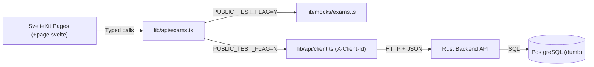

# Frontend Architecture & Tech Stack

This document describes the technology stack, folder structure, data flow, and architectural patterns used in the `frontend/` application.

## 1. Technology Stack

| Layer | Technology | Version (from `package.json` / `versions.json`) | Purpose |
| :--- | :--- | :--- | :--- |
| **Runtime & Package Manager** | Node.js / npm | `26.7.0` / `11.19.0` | Local tooling, Vite dev server, and production builds |
| **UI Framework** | Svelte (Runes mode) | `^5.57.3` | Reactive UI with `$state`, `$derived`, `$effect`, and `$props` |
| **App Framework** | SvelteKit | `^3.2.0` | File-based routing, `$app/env/public`, `$app/paths`, `$app/state`, `$app/navigation` |
| **Bundler** | Vite | `^8.3.8` | Fast HMR dev server and SSR/client production bundling |
| **Styling** | Tailwind CSS v4 (`@tailwindcss/vite`) | `^4.3.5` | CSS-first utility styling and `@theme` design tokens |
| **Language** | TypeScript (`strict: true`) | `^6.0.3` | End-to-end type safety across routes, API contracts, and components |
| **Linting & Formatting** | ESLint + Prettier (`prettier-plugin-tailwindcss`) | `^10.15.0` / `^3.10.1` | Code quality, Svelte 5 lint rules, and consistent class/code formatting |
| **Type Diagnostics** | `svelte-check` | `^4.7.8` | Static template and TypeScript verification |

---

## 2. Directory Structure

```text
frontend/
├── vite.config.ts                  # Vite + SvelteKit config (@sveltejs/adapter-node, env.dir = '..')
├── tsconfig.json                   # TypeScript config with #lib/* path aliases
├── eslint.config.js                # ESLint flat config (tsconfigRootDir = import.meta.dirname)
└── src/
    ├── app.html                    # Root HTML shell
    ├── env.ts                      # SvelteKit 3 explicit env declarations (defineEnvVars)
    ├── routes/
    │   ├── layout.css              # Tailwind v4 @import & dark-mode @theme tokens
    │   ├── +layout.svelte          # App shell (Header + centered <main> container)
    │   ├── +page.svelte            # Home: server-driven exam list with infinite scroll
    │   └── exams/
    │       └── [id]/
    │           ├── +page.svelte    # Exam Overview: stats, Topics list, Start/Continue links
    │           └── practice/
    │               └── +page.svelte # Practice: URL-driven (?q= & ?topic=), instant check, keywords
    └── lib/
        ├── api/
        │   ├── client.ts           # Base fetch wrapper (PUBLIC_TEST_FLAG, PUBLIC_API_BASE_URL, X-Client-Id)
        │   └── exams.ts            # Typed API functions switching between mock and real Rust backend
        ├── mocks/
        │   └── exams.ts            # Server-behavior mock implementations (used when PUBLIC_TEST_FLAG=Y)
        ├── types/
        │   └── exam.ts             # Shared TypeScript interfaces matching the Rust JSON contract
        ├── state/
        │   └── header.svelte.ts    # Reactive header state (examCode, showVi)
        ├── utils/
        │   └── client-id.ts        # Browser UUID generator/reader (localStorage key: dump_client_id)
        └── components/
            ├── Header.svelte       # Sticky dark header (D logo, dynamic Home/exam code, VN toggle)
            └── ExamCard.svelte     # Clickable exam summary card with progress bar
```

---

## 3. Architecture & Data Flow

The frontend is **server-driven**: it does not filter, paginate, grade, or cache exam datasets in memory. All business calculations reside on the backend (simulated by `src/lib/mocks/exams.ts` while `PUBLIC_TEST_FLAG=Y`).



---

## 4. Key Design Patterns

### Routing & Navigation
1. **Home (`/`):** Renders a debounced search input (300ms), status filter tabs (`All`, `In progress`, `Not started`, `Completed`), and a responsive grid of `ExamCard` components. Uses `IntersectionObserver` (`rootMargin: '200px'`) to fetch the next page automatically (`GET /api/exams?page=...&limit=6`).
2. **Exam Overview (`/exams/[id]`):** Calls lightweight `getExamOverview(id)` (`GET /api/exams/:id`) to display exam metadata, summary stats, and the **Topics** list with server-computed `answeredCount` and a single synchronized `Continue` point.
3. **Practice Session (`/exams/[id]/practice`):** Driven by URL query parameters `?q=<questionIndex>` and optional `?topic=<topicId>`.
   - Navigating (`Previous`, `Next`, or Question Navigator) updates `?q=` via `goto(...)`, triggering `getExamQuestion(...)` to fetch that single question and persist `lastQuestionIndex`.
   - Clicking an option immediately calls `submitExamAnswer(...)` (no separate `Check Answer` button) and reveals correctness, explanation, and **Keywords**.

### State Management & Browser Storage
- **Component & Cross-Route State:** Uses Svelte 5 runes (`$state`, `$derived`, `$effect`). Shared header state (`examCode`, `showVi`) lives in `src/lib/state/header.svelte.ts`.
- **Zero Data Caching:** When `PUBLIC_TEST_FLAG=N`, no exam lists, questions, or answers are cached in the browser.
- **`localStorage` Keys:**
  - `dump_client_id`: Auto-generated UUID v4 text (or user-customized ID) saved in `localStorage`, registered/updated via `/api/clients/*` and sent on every API request via `X-Client-Id`.
  - `dump_show_vi`: Persists whether the **`VN`** bilingual translation toggle is active.
  - `dump_mock_progress_v1`: Used **only** by `src/lib/mocks/exams.ts` when `PUBLIC_TEST_FLAG=Y`.

### Styling & Dark Mode
- **Dark Mode Only:** Configured via `@theme` tokens (`--color-bg`, `--color-surface`, `--color-surface-hover`, `--color-border`, `--color-text`, `--color-text-muted`, `--color-accent`) and `color-scheme: dark` in `src/routes/layout.css`. No light-mode theme or toggle is included.

### Environment Configuration
- `vite.config.ts` sets `env: { dir: '..' }` inside `sveltekit(...)` so the frontend reads the repository-root `.env` file (`PUBLIC_TEST_FLAG` and `PUBLIC_API_BASE_URL`).
- Variables are declared with `defineEnvVars` in `src/env.ts` and imported via SvelteKit 3's `$app/env/public`.

---

## 5. Development & Verification Commands

Run inside `frontend/`:

```powershell
npm run dev      # Start Vite dev server (http://localhost:5173/)
npm run check    # Run svelte-kit sync && svelte-check
npm run lint     # Run Prettier check && ESLint
npm run format   # Auto-format all files with Prettier
npm run build    # Build SSR & client production bundles
```
